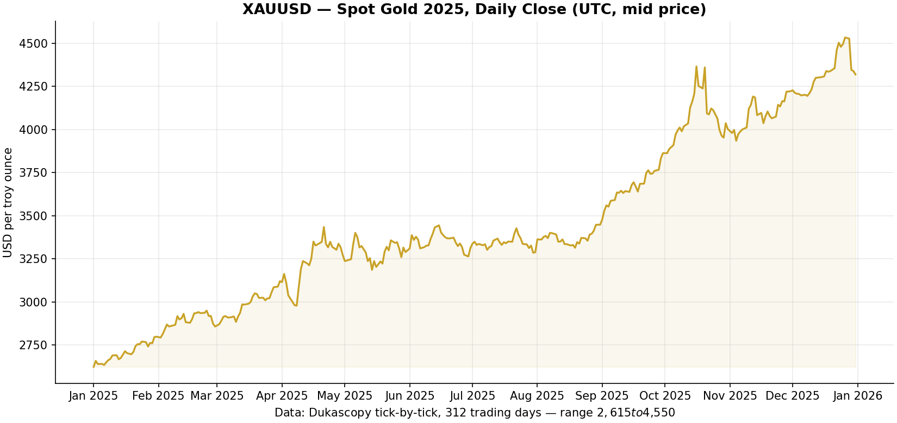

# XAUUSD Tick Data 2025 — Free Gold Tick-by-Tick Historical Dataset (Full Year, CSV)

**Complete tick-by-tick historical data for spot gold (XAU/USD) for the full 2025 calendar year** — **71,403,972 real ticks** (January 1 → December 31) with UTC millisecond timestamps, bid & ask prices and volumes, extracted from **Dukascopy Bank SA's public data feed**. Free to download, pandas-ready, backtesting-ready — no signup, no paid API, no scraping required.

If you need high-resolution gold data for backtesting, quantitative research, machine learning, spread analysis or MetaTrader 5 — this repository gives you the whole of 2025 in 53 convenient weekly CSV.gz files, plus daily OHLCV aggregates, per-week statistics, verification tooling and ready-made import scripts.



> **Looking for 2024 data?** The companion repository
> **[Touhid-HZ/xauusd-tick-data-2024](https://github.com/Touhid-HZ/xauusd-tick-data-2024)**
> covers the complete 2024 calendar year — 56,217,145 ticks in 53 weekly files: gold's breakout year.
> **Looking for 2026?** [Touhid-HZ/xauusd-tick-data-2026](https://github.com/Touhid-HZ/xauusd-tick-data-2026)
> covers 2026 with 78.9M+ ticks and is auto-updated every week.

---

## Dataset at a glance

| | |
|---|---|
| **Instrument** | XAUUSD — Spot Gold vs US Dollar (OTC) |
| **Data type** | Tick-by-tick quotes (every price update, not bars) |
| **Coverage** | 2025-01-01 → 2025-12-31 (UTC) — complete calendar year, final |
| **Total ticks** | **71,403,972** |
| **Days with data** | 312 (260 weekdays + 52 Sundays) |
| **Price range** | $2,614.70 – $4,550.13 per troy ounce (mid price) |
| **2025 performance** | Gold rallied **~+74%** — from $2,614.70 (January) to $4,550.13 (December) |
| **Timestamps** | UTC (GMT), millisecond precision, sorted |
| **Columns** | `timestamp, ask, bid, ask_volume, bid_volume` |
| **Package size** | ~534 MB compressed (53 weekly `.csv.gz` files, 3.3–18.7 MB each) |
| **Source** | Dukascopy Bank SA public data feed (bi5, decoded) |
| **License** | MIT (code & packaging); see disclaimer below |
| **Bonus** | Daily OHLCV file, per-week stats JSON, machine-readable `DATA_STATUS.json`, chart |

## Why this dataset?

- **True tick data, not 1-minute bars.** Bars hide intra-second moves, spread behaviour and quote dynamics. This is the raw feed — 71.4 million rows for 2025 alone, the same resolution professional backtesters use.
- **A complete, final calendar year.** Every trading session of 2025, January 1 through December 31 — ideal for studying the 2025 gold bull run ($2,614 → $4,550) and building year-long walk-forward tests.
- **Bid AND ask with volumes.** Model realistic fills, slippage and spread costs — impossible with close-only data.
- **Millisecond UTC timestamps**, sorted, raw feed preserved (no interpolation, no deduplication), verified programmatically row by row (see [Data quality](#data-quality--verification)).
- **Human & machine friendly.** Weekly gzip CSVs that load in one `pandas.read_csv` line; `DATA_STATUS.json` + `llms.txt` give AI agents and pipelines an instant overview.
- **Reproducible.** All downloader/converter scripts are included, plus the exact `dukascopy-node` command used to build the dataset.
- **Companion 2026 repository.** Combine both for multi-year, year-over-year regime analysis.

## Repository structure

```text
xauusd-tick-data-2025/
├── README.md                        ← you are here
├── DATA_STATUS.json                 ← machine-readable coverage/totals/inventory
├── data_dictionary.md               ← full schema documentation
├── llms.txt                         ← compact summary for AI agents
├── LICENSE                          ← MIT
├── CITATION.cff                     ← citation metadata
├── CONTRIBUTING.md                  ← how to report issues / rebuild
├── charts/
│   └── XAUUSD_2025_daily_close.png  ← 2025 daily close overview chart
├── data/
│   ├── tick/
│   │   ├── XAUUSD_2025_w01.csv.gz   ← week 1: 2025-01-01 .. 2025-01-07
│   │   ├── ...                      ← one file per 7 days
│   │   ├── XAUUSD_2025_w53.csv.gz   ← final (1-day) week: 2025-12-31
│   │   └── XAUUSD_2025_wNN.meta.json← per-week stats sidecars
│   └── daily/
│       └── XAUUSD_2025_daily_ohlcv.csv  ← 2025 daily OHLCV (mid price)
└── scripts/
    ├── download_ticks.py            ← pure-Python downloader (bi5 → weekly gz)
    ├── download_weeks_node.py       ← bulk downloader via dukascopy-node
    ├── build_daily_ohlcv.py         ← rebuild daily OHLCV + DATA_STATUS.json
    ├── make_chart.py                ← re-render the overview chart
    ├── verify_data.py               ← integrity checker (all files, all rows)
    ├── examples/
    │   ├── load_and_resample.py     ← pandas quickstart: ticks → 1-min candles
    │   └── convert_to_parquet.py    ← CSV.gz → fast Parquet dataset
    └── metatrader/
        ├── ImportXAUUSDTicks.mq5    ← MT5 custom-symbol tick importer
        ├── prepare_csv.py           ← merge weeks into one MT5-ready CSV
        └── README.md                ← step-by-step MetaTrader guide
```

## Data schema

Every weekly file has the identical header:

```csv
timestamp,ask,bid,ask_volume,bid_volume
2025-01-01 23:00:00.455,2626.592,2625.098,0.000450,0.000450
2025-01-01 23:00:00.557,2626.482,2625.698,0.000450,0.000450
2025-01-01 23:00:00.608,2626.482,2625.298,0.000450,0.000450
```

| Column | Meaning | Notes |
|---|---|---|
| `timestamp` | Quote time, **UTC**, `YYYY-MM-DD HH:MM:SS.mmm` | millisecond precision, sorted ascending |
| `ask` | Best ask, USD per troy ounce | 3 decimals; `ask ≥ bid` on every row |
| `bid` | Best bid, USD per troy ounce | 3 decimals |
| `ask_volume` | Ask-side volume, **millions of units** | Dukascopy convention: `0.000450` = 450 units |
| `bid_volume` | Bid-side volume, **millions of units** | indicative feed activity, not exchange contracts |

Full details, sidecar formats and provenance: [data_dictionary.md](data_dictionary.md).

## Quick start (Python / pandas)

```python
import pandas as pd

# one week of 2025
df = pd.read_csv(
    "data/tick/XAUUSD_2025_w05.csv.gz",
    parse_dates=["timestamp"],
    date_format="%Y-%m-%d %H:%M:%S.%f",
)
print(len(df), df.head())

# spread & mid price
df["spread"] = df["ask"] - df["bid"]
df["mid"]    = (df["ask"] + df["bid"]) / 2

# resample ticks to 1-minute OHLC candles
ohlc = df.set_index("timestamp")["mid"].resample("1min").ohlc()
```

Streaming the whole year without loading 71M rows at once:

```python
import glob, pandas as pd

for path in sorted(glob.glob("data/tick/XAUUSD_2025_w*.csv.gz")):
    for chunk in pd.read_csv(path, chunksize=2_000_000):
        ...  # process chunk
```

More examples: [scripts/examples/](scripts/examples/) — including a
Parquet converter that loads ~5× faster than CSV.

## Getting the data

| Method | Command / link |
|---|---|
| Clone everything (~534 MB of data) | `git clone https://github.com/Touhid-HZ/xauusd-tick-data-2025.git` |
| Single zip, one click (no git) | [Releases](../../releases) → `XAUUSD_tick_data_2025-01-01_2025-12-31.zip` |
| Individual weeks | `wget https://raw.githubusercontent.com/Touhid-HZ/xauusd-tick-data-2025/main/data/tick/XAUUSD_2025_w01.csv.gz` |
| Daily OHLCV only (small) | `data/daily/XAUUSD_2025_daily_ohlcv.csv` |

## Import into MetaTrader 5

The included MQL5 script builds a **custom symbol** (e.g. `XAUUSD_T2025`) and
streams the ticks in via `CustomTicksAdd`, so you can chart 2025 gold or
run the Strategy Tester in *"Every tick based on real ticks"* mode.

```bash
python scripts/metatrader/prepare_csv.py   # merge weeks -> one plain CSV
# copy it to <MT5 data folder>\MQL5\Files\, then run ImportXAUUSDTicks.mq5
```

Full guide: [scripts/metatrader/README.md](scripts/metatrader/README.md).

## Statistics — XAUUSD tick data by month (2025)

| Month | Days | Ticks | High ($) | Low ($) | Avg spread ($) |
|---|---:|---:|---:|---:|---:|
| 2025-01 | 27 | 5,798,226 | 2,817.15 | 2,614.70 | 0.56 |
| 2025-02 | 24 | 5,815,774 | 2,956.25 | 2,772.22 | 0.68 |
| 2025-03 | 26 | 5,394,235 | 3,128.12 | 2,855.70 | 0.56 |
| 2025-04 | 25 | 6,162,648 | 3,500.22 | 2,956.58 | 0.76 |
| 2025-05 | 26 | 5,325,454 | 3,438.47 | 3,120.70 | 0.75 |
| 2025-06 | 26 | 4,752,206 | 3,451.89 | 3,247.80 | 0.63 |
| 2025-07 | 27 | 4,192,283 | 3,439.03 | 3,268.16 | 0.60 |
| 2025-08 | 26 | 4,332,294 | 3,453.85 | 3,281.69 | 0.61 |
| 2025-09 | 26 | 5,823,801 | 3,871.85 | 3,437.07 | 0.63 |
| 2025-10 | 27 | 9,296,611 | 4,381.56 | 3,819.41 | 0.76 |
| 2025-11 | 25 | 6,537,897 | 4,245.19 | 3,928.77 | 0.76 |
| 2025-12 | 27 | 7,972,543 | 4,550.13 | 4,163.77 | 0.81 |
| **Total** | **312** | **71,403,972** | **4,550.13** | **2,614.70** | — |

Extra facts computed from the data:

- Gold's 2025 rally: from **$2,614.70 (January) to $4,550.13 (December)** — a **~+74%** year.
- Busiest month: **October 2025** with 9,296,611 ticks, as volatility exploded during the breakout.
- Busiest trading day: **2025-10-17** with 591,556 ticks.
- Busiest week: **w42** (mid-October) with 2,409,488 ticks — the largest weekly file (18.7 MB).
- Average density: ~229,000 ticks per trading day (≈ 2.6 ticks per second, around the clock).
- The only zero-tick weekday in 2025 is the Good Friday holiday, **2025-04-18**. January 1 traded only late in the day (from ~23:00 UTC); December 31 closed early (~21:58 UTC).
- Average bid-ask spread across the year: **$0.63** per ounce.
- Daily OHLCV aggregates: [data/daily/XAUUSD_2025_daily_ohlcv.csv](data/daily/XAUUSD_2025_daily_ohlcv.csv).

## Data quality & verification

- **Cross-validated against dukascopy-node**: an entire trading hour was
  decoded independently by this repo's decoder and by the popular
  [dukascopy-node](https://github.com/LeoEichler/dukascopy-node) exporter —
  **11,708 / 11,708 rows identical** (timestamps, prices, volumes).
- **Full-file integrity check** (`scripts/verify_data.py`): all 53 files,
  all 71,403,972 rows — schema, monotonic timestamps, `ask ≥ bid`,
  price bounds, non-negative volumes, row counts vs sidecars: **0 problems**.
- **No gaps**: every weekday except Good Friday (2025-04-18) has ticks;
  Sundays resume at the regular ~22:00 UTC spot-gold open.
- Raw feed is preserved as-is: no interpolation, no deduplication, no
  gap-filling. Identical millisecond timestamps can and do occur — that is
  genuine feed behaviour, not duplication.

## How the data was built (fully reproducible)

1. Hourly `.bi5` tick archives are fetched from Dukascopy's public feed
   (`https://datafeed.dukascopy.com/datafeed/XAUUSD/...`).
2. Each `.bi5` is LZMA-decompressed into 20-byte big-endian records
   (`ms_offset, ask×1000, bid×1000, ask_vol_m, bid_vol_m`).
3. Rows are re-timestamped to UTC ISO format, grouped into 7-day chunks and
   written as gzip CSVs with stats sidecars.

The equivalent one-liner for a single range (what this repo automates):

```bash
npx dukascopy-node -i xauusd -from 2025-01-01 -to 2025-02-01 -t tick -f csv -v
```

Run `python scripts/download_weeks_node.py --from 2025-01-01 --to 2026-01-01` to
reproduce the full year, or `python scripts/download_ticks.py` for the
dependency-light pure-Python path.

## A final, immutable dataset

2025 is a closed calendar year — **this repository will not change**. The data
files here are final, and `DATA_STATUS.json` documents the exact coverage and
totals. A [GitHub Action](.github/workflows/validate-data.yml) can re-run the
integrity checker on demand from the Actions tab.

For 2026 data (78.9M+ ticks, auto-updated every Monday), see the companion
repository: **[xauusd-tick-data-2026](https://github.com/Touhid-HZ/xauusd-tick-data-2026)**.

## FAQ

**Is this really free XAUUSD tick data?**
Yes — the repository (data + scripts) is usable under the MIT license for research, education and personal use. The underlying quotes originate from Dukascopy Bank SA's public feed; see the disclaimer below.

**What exactly is tick data?**
One row per quote update of the market — every change of best bid/ask. Compared to 1-minute bars (≈ 100k rows/year) this dataset has **71.4 million rows for 2025**, capturing every intra-second move, spread widening and microstructure detail.

**Which period is covered?**
The complete calendar year **2025** — January 1 through December 31, 71,403,972 ticks, 312 trading days. The dataset is final and will not change. For 2026, see the companion repo [xauusd-tick-data-2026](https://github.com/Touhid-HZ/xauusd-tick-data-2026).

**What timezone are the timestamps in?**
UTC (GMT), including milliseconds. The daily OHLCV file uses UTC dates too (the trading day ends at ~22:00 UTC when spot gold pauses for the daily break).

**Is this the same gold price as TradingView / my broker shows?**
Close but not identical. This is Dukascopy's OTC spot gold feed. Broker feeds and COMEX futures (GC) can differ by a few dollars/cents and in tick timing. For gold-strategy backtesting on XAUUSD CFDs, an OTC spot feed like this is the right reference.

**How do I convert ticks to 1-minute or 1-hour OHLC bars?**
See the quick start above (`resample("1min").ohlc()`) or `scripts/examples/load_and_resample.py`. Prebuilt daily bars are included.

**Can I use it with MetaTrader 4/5?**
Yes for MT5 — the included `ImportXAUUSDTicks.mq5` creates a custom symbol with real ticks (guide: `scripts/metatrader/README.md`). MT4 has no tick-import API; convert to bars instead.

**How big is the download? Which file should I get?**
Each weekly `.csv.gz` is 3.3–18.7 MB (~534 MB for the whole year). Grab only the weeks you need, or the single full-year zip from the [Releases](../../releases) page.

**Why do some ticks share the same timestamp?**
Genuine feed behaviour: several quote updates can land in the same millisecond. Nothing was deduplicated — raw feed is preserved.

**What about volumes — are they real traded volume?**
They are Dukascopy's indicative per-side volumes (millions of units), typical for OTC feeds — activity/liquidity proxies, not exchange-traded contract volumes.

**How was the data verified?**
Row-by-row cross-validation against dukascopy-node plus a full integrity sweep of every file and every row — see [Data quality](#data-quality--verification).

## XAUUSD tick data — alternatives comparison

| Source | Resolution | Bid+Ask | Volumes | Format | Effort |
|---|---|---|---|---|---|
| **This repo** | tick (ms) | yes | yes | CSV.gz, Parquet-convertible, MT5 | clone & read |
| Dukascopy (manual) | tick (ms) | yes | yes | bi5 binary (needs decoding) | high |
| dukascopy-node (CLI) | tick (ms) | yes | yes | CSV (one big file, raw epochs) | medium |
| HistData.com | 1 minute | bid only | no | CSV/ZIP per month | medium |
| Yahoo Finance / stooq | 1 day | close only | partial | CSV | trivial |
| TradingView export | 1 second+ | no | no | CSV, manual | medium |
| Paid vendors (TickData, etc.) | tick | yes | yes | various | paid |

## Related repositories

- **[xauusd-tick-data-2024](https://github.com/Touhid-HZ/xauusd-tick-data-2024)** — the same dataset for 2024 (56,217,145 ticks): gold's breakout year, complete and immutable.
- **[xauusd-tick-data-2026](https://github.com/Touhid-HZ/xauusd-tick-data-2026)** — the same dataset for 2026 (78.9M+ ticks so far), auto-updated every week via GitHub Actions.

## Attribution & disclaimer

- **Data source:** Dukascopy Bank SA — public historical data feed
  (`datafeed.dukascopy.com`). This repository is an independent, reproducible
  packaging of that public feed, cross-validated with
  [dukascopy-node](https://github.com/LeoEichler/dukascopy-node).
- The dataset is provided **as-is** for research, education and personal use,
  without any warranty of accuracy or fitness for trading decisions.
- Nothing here is investment advice. Trading gold (XAUUSD) involves
  substantial risk.

## License

Code, packaging and documentation: **[MIT](LICENSE)**.
Market data belongs to its original source and is redistributed here in good
faith from a publicly accessible feed for research purposes.

---

**Found this useful?** ⭐ Star the repo — it helps other people searching for
*free XAUUSD tick data*, *gold historical data download*, *XAUUSD 2025 data*
and *gold backtesting data* find it too. Issues and PRs are welcome!
